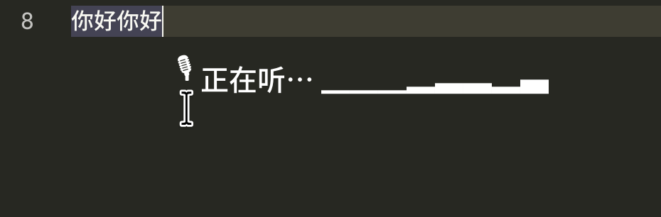

# fcitx5-voice

本地语音输入的 fcitx5 插件：**按住右 Alt 说话，松开就上屏**，也支持"点一下说话、说
完静音自动结束"。识别在本机完成，录音不上传。



- 不写输入法引擎，只在 fcitx5 的 `PreInputMethod` 阶段拦截语音键，其余按键照常交给
  当前输入法（rime / fcitx5-pinyin 等）；
- Rust 核心（热键状态机 / 重采样 / VAD / 上屏差分）静态链接进 C++ 插件，一个 `.so` 搞定；
- 识别后端可换：默认接 `whisper-cli`，也能换成 sherpa-onnx、本地其它命令行识别器；
- **Nix 包自带 whisper `ggml-base` 模型**（约 141MB），装完即用，不用自己下模型。

## 它是怎么工作的

```
          ┌─ 按下右 Alt ─┐                     ┌─ 松开 / 静音超时 ─┐
键盘 ───> │ fcitx5 事件 │ ──PreInputMethod──> │ 本插件              │ ──commitString──> 应用
          └─────────────┘                     └───────────────────┘
                                                    │ C ABI
                                                    v
                                        Rust 核心：热键状态机 → cpal 录音
                                        → 降混/重采样到 16k → 20ms 分帧 + VAD
                                        → 识别后端（写 WAV → 读 stdout）
                                        → 公共前缀差分 → 退格 + 插入
```

和 WowType 的思路一致（都是「C++ 外壳 + Rust 引擎」），区别是这里不实现拼音、也
不内置推理代码，靠外部识别器；Nix 包会把 whisper `ggml-base` 模型和 `whisper-cli`
一起装进来，所以装上就能用、也能换引擎。

## 依赖

- fcitx5 ≥ 5.0（开发时用的是 5.0.21，5.1 也可）
- Rust（`cargo`）
- `libasound2-dev`（ALSA，麦克风采集）或构建时加 `-DVOICE_CAPTURE=OFF`
- 一个本地识别后端。**用 Nix 的话这两样都自带**（见下）；手动构建时自己准备：
  ```bash
  # 程序
  sudo apt install whisper.cpp          # Debian/Ubuntu，或自行编译
  # 模型（约 141MB）—— 用 Nix 包时无需这一步
  whisper-cpp-download-ggml-model base
  ```

## 构建（不用 Nix）

```bash
cargo build --release -p fcitx5-voice-core      # 先出 Rust 静态库
cmake -S . -B build -DCMAKE_BUILD_TYPE=Release
cmake --build build
sudo cmake --install build                       # 装到 <prefix>/lib/fcitx5 与 share/fcitx5
```

不带麦克风（只用外部 WAV 测试）可以 `-DVOICE_CAPTURE=OFF`。

## 安装

### Nix / NixOS（推荐）

```bash
nix profile install github:jcleng/fcitx5-voice   # 自带 whisper-cli 与 ggml-base 模型（约 141MB）
```

装好后在 `fcitx5-configtool` 里启用 `voice` 插件即可。本包**不是**独立程序，没有可执行文件，
不要用 `nix run` 启动。

NixOS `flake.nix` 加 input：

```nix
{
  inputs.fcitx5-voice.url = "github:jcleng/fcitx5-voice/v0.1.0";
}
```

`configuration.nix` 里把它加到 fcitx5 的 addons（配合 `i18n.inputMethod.type = "fcitx5"`）：

```nix
{ inputs, pkgs, ... }:
{
  i18n.inputMethod.enable = true;
  i18n.inputMethod.type = "fcitx5";
  i18n.inputMethod.fcitx5.addons = [
    pkgs.fcitx5-rime
    inputs.fcitx5-voice.packages.${pkgs.stdenv.hostPlatform.system}.default
  ];
}
```

通过Cachix提供二进制缓存（把下面这段加进你自己的 `flake.nix` 顶层即可，不用改上面的 input）：

```nix
nixConfig = {
  extra-substituters = [ "https://jcleng-dev.cachix.org" ];
  extra-trusted-public-keys = [ "jcleng-dev.cachix.org-1:z9ANWkDcDZfbUGK12osxOaX4u4A9kmhnRKu3Oh5OQcc=" ];
};
```

> 注意是 `i18n.inputMethod.fcitx5.addons`，不是
> `services.xserver.desktopManager.fcitx5.addons`（那个选项在 NixOS 里不存在）。

### 开发

```bash
nix build .#default     # 构建本包
nix flake check         # 单测 + C ABI 行为测试 + 安装后 smoke 测试
nix develop             # cargo / cmake / fcitx5 头文件都在
```

## 配置

改 `~/.config/fcitx5/conf/voice.conf`（在 `fcitx5-configtool` 里点本插件也能改），
或直接用环境变量：

| 键 | 默认 | 说明 |
|---|---|---|
| `BackendCommand` | `whisper-cli -m <模型> -l zh -nt -f` | 识别命令（Nix 包里已指向自带的 whisper-cli 与模型），末尾自动追加 WAV 路径；可加 `sherpa-*:` / `stream:` 前缀，见[换识别后端](#换识别后端) |
| `VoiceKey` | `Alt_R` | 语音键：`Alt_L` / `Alt_R` / `Control_R` / `Menu` |
| `HoldMs` | `300` | 长短按分界（毫秒）；按住即说、松开即停 |
| `SilenceMs` | `1500` | 点按模式下静音多久自动结束 |
| `ShowPreedit` | `true` | 是否在光标处显示录音/识别提示（key 名沿用旧名，语义即下方的 overlay 提示） |
| `Enabled` | `true` | 总开关 |

环境变量（优先级高于配置文件）：

```bash
FCITX5_VOICE_BACKEND='whisper-cli -m /path/ggml-base.bin -l zh -nt -f'
FCITX5_VOICE_HOLD_MS=300
FCITX5_VOICE_SILENCE_MS=1500
```

### 模型在哪

用 Nix 包装的时候，模型和 whisper-cli 一起在 store 里，默认命令已经指过去：

```
<nix store>/share/fcitx5-voice/ggml-base.bin
```

想换更大的模型（`ggml-small` 约 466MB、`ggml-medium` 约 1.5GB），改 `nix/package.nix`
里的 `whisperModel`（`url` + `hash`），或用 `FCITX5_VOICE_BACKEND` 指向自己的模型路径。

非 Nix 安装：把模型放在任意位置，用 `BackendCommand` 的 `-m` 指过去即可。

### 换识别后端

只要是「读一个 WAV 路径、把文本打到 stdout」的命令都行：

```bash
# whisper.cpp
BackendCommand=whisper-cli -m /usr/share/whisper/ggml-base.bin -l zh -nt -f

# sherpa-onnx（离线 paraformer）
BackendCommand=sherpa-onnx-offline --tokens=/path/tokens.txt --paraformer=/path/model.onnx --wav=
```

命令里带空格的路径用引号包起来即可。

### 用 sherpa-onnx（含流式模型）

`BackendCommand` 支持前缀选择后端，不写前缀就仍是上面那个通用 `ProcessChannel`：

| 前缀 | 作用 | `partial()` |
|---|---|---|
| （无） | 通用「写 WAV 调命令行」 | `None` |
| `sherpa-offline:` / `sherpa:` / `sherpa-streaming:` | sherpa-onnx CLI（会去掉重复的 `--wav=`） | `None` |
| `stream:` | 支持 stdin 流式协议的外部命令 | **有**（边说边出字） |

装上 sherpa-onnx 和流式 zipformer 模型（中英混说约 190MB）：

```bash
# NixOS: nix shell nixpkgs#sherpa-onnx
wget https://github.com/k2-fsa/sherpa-onnx/releases/download/asr-models/\
  sherpa-onnx-streaming-zipformer-bilingual-zh-en-2023-02-20.tar.bz2
tar xjf sherpa-onnx-streaming-zipformer-bilingual-zh-en-2023-02-20.tar.bz2
```

配置（`~/.config/fcitx5/conf/voice.conf` 或 `FCITX5_VOICE_BACKEND`）：

```bash
FCITX5_VOICE_BACKEND='sherpa-streaming:sherpa-onnx \
  --tokens=<dir>/tokens.txt \
  --encoder=<dir>/encoder-epoch-99-avg-1.onnx \
  --decoder=<dir>/decoder-epoch-99-avg-1.onnx \
  --joiner=<dir>/joiner-epoch-99-avg-1.onnx'
```

> **注意**：`sherpa-streaming:` 前缀**不**代表边说边出字。sherpa-onnx 的命令行工具只吃
> **WAV 文件路径**（`csrc/sherpa-onnx.cc` 里 `po.NumArgs() < 1` 就报错，音频全走
> `ReadWave(filename)`），没有 `-`/stdin 约定，也没有 `--print-partial` 选项，结果只在
> 解码结束后一次性写出来。所以它和 whisper 一样是一次性识别，`partial()` 仍是 `None`。
> 前缀只是让配置意图清楚、并支持 `--wav=` 去重。
>
> **真流式**需要 `stream:` 前缀，见下。

### 真流式（`stream:` 前缀）

`StreamingChannel` 自己起子进程、把 PCM 持续写进它的 stdin、逐行读 stdout 拿中间结果。
协议很小，任何语言都能实现：

- **stdin**：裸 16kHz 单声道 `i16` 小端 PCM（无 WAV 头），说完就关闭 stdin；
- **stdout**：每输出一行 = 「整句当前的识别结果」（覆盖式，不是增量），fcitx5-voice 会
  自己跟上一版做公共前缀差分算退格/插入；
- 关闭 stdin 后进程退出前，stdout 的**最后一行**就是最终结果；
- stderr 会被丢弃。

```bash
FCITX5_VOICE_BACKEND='stream:/path/to/my-streaming-asr --lang zh'
```

这样不用写 unsafe FFI 也能接真流式引擎：写个小 wrapper 包一层 sherpa-onnx 的 C API
（`SherpaOnnxCreateOnlineStream` / `SherpaOnnxOnlineStreamAcceptWaveform` /
`SherpaOnnxIsOnlineStreamReady` / `SherpaOnnxDecodeOnlineStream` /
`SherpaOnnxGetOnlineStreamResult`）按上面协议输出即可。

> **已经接到屏幕上**：`src/voice.cpp` 的 `poll()`（50ms）会消费
> `voice_take_update()` 的增量，用 `deleteSurroundingText` + `commitString` 打到焦点
> 输入框；松手时用最后一次差分把「屏幕上的旧文本」修正成最终结果，不会重复上屏。
> 独立 addon 写不了真正的 preedit，所以是逐字刷而非平滑插入，字多时会有轻微闪动。

## 行为

- 按下右 Alt 开始录音；
- 按住 ≥300ms 松开 → 立即结束并上屏（长按说话）；
- 按得比 300ms 短 → 判为「点按」，继续录，静音 1.5 秒或再按一次才结束；
- 单次最长 120 秒；
- 说话时按 `Esc` 丢弃；按别的键也丢弃、那个键照常处理；
- 结果只往开始说话时的那个输入框上屏；
- 没配后端时按语音键只报错，不开麦克风。

### 光标处的提示（overlay）

录音/识别时会在光标处（候选框的位置）显示一行提示：

- 录音中：`🎙 正在听… ▁▂▄▆█▆▄▂` —— 后面 8 格竖条随麦克风音量跳动，越靠右越新；
- 识别中：`⏳ 识别中…`；
- 上屏、取消（Esc / 按别的键）或出错时自动消失。

实现用的是 `InputPanel::setOverlayMessage()`（fcitx5 **5.1.22 起**才有）。低版本编译时
没有这个符号，插件会**自动编译成不显示提示**、语音功能本身不受影响。当当前输入法
（如 rime）正在显示候选时，overlay 会让位、暂时不显示，这是正常行为。

提示文字含有 `🎙`（U+1F399），字体里没有时 fontconfig 会 fallback 到 Noto Sans Symbols 2；
想关掉把 `ShowPreedit` 设为 `false`。

## 测试

```bash
cargo test -p fcitx5-voice-core          # Rust 核心单测（状态机 / 分帧 / VAD / 差分）
nix flake check                           # 含 C ABI 行为测试与安装后 smoke 测试
```

`test/key_harness.cpp` 直接调 C ABI，验证「没有后端不开麦克风」「长按/点按状态机」
「点按静音超时」等行为。

## 已知限制

- **不显示"边说边出字"的实时预览**：独立 addon 不是输入法引擎，无法直接写编辑区
  preedit（那是 `InputMethodEngine` 的职责，会和当前 rime/pinyin 抢）。当前只在结束时
  一次性 `commitString`；光标处只有上面的状态提示（overlay 只能放纯文本、候选出现时
  还会让位）。要真正的流式预览需要接一个候选/预览 UI（GNOME 扩展或 kimpanel）。
- 官方 CLI 只有离线识别：sherpa-onnx 的 `sherpa-onnx` / `sherpa-onnx-vad-with-online-asr`
  都只接受 WAV 文件路径、不能从 stdin 连续喂 PCM，也没有 `--print-partial`。想要真流式
  得用 `stream:` 前缀自己接一个支持 stdin 的 wrapper（或写 C API FFI）。
- `ProcessChannel` / `SherpaChannel` 的中间结果恒为 `None`，识别在后端整体跑一遍。
- 右 Alt 在很多布局是 `ISO_Level3_Shift`（AltGr），代码已把两者都认作语音键；若你依赖
  AltGr 输入，请把 `VoiceKey` 改成别的键。

## 与 WowType / Rime Lua 的关系

- **WowType** 是完整输入法（自建拼音 + 自负荷微信离线模型推理），语音是其中一块；
  本项目借它同源的链路设计，但只做语音、且不绑模型。
- **Rime Lua** 做不了：Lua 拿不到麦克风、跑不了 ASR、没有按键外的定时驱动，右 Alt 的
  按下/松开也无法稳定地与拼音共处。

## 许可

MIT OR Apache-2.0。`core/` 中热键状态机、重采样、VAD 与上屏差分的设计参考了
[WowType](https://github.com/Gloridust/WowType)（其语音部分源自
[voicekey](https://github.com/J3n5en/voicekey)），同样以 MIT/Apache 授权。
